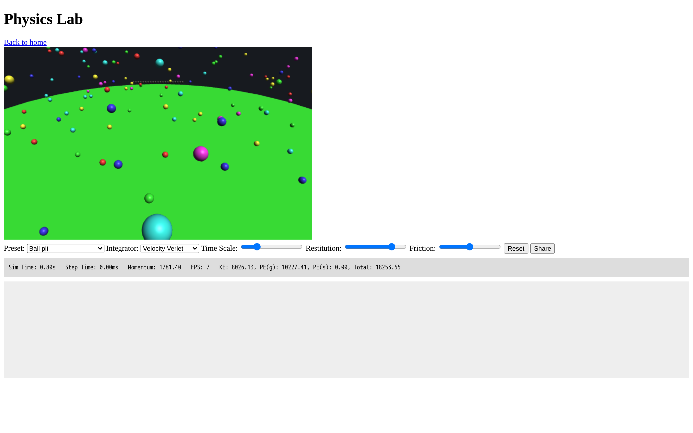
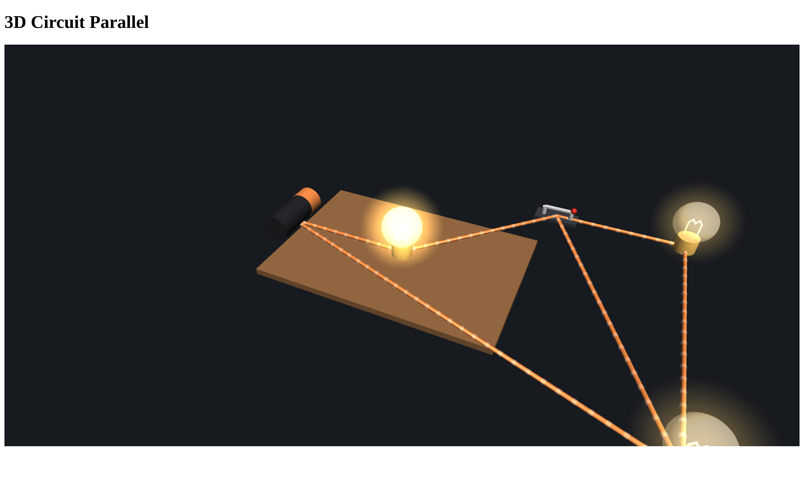
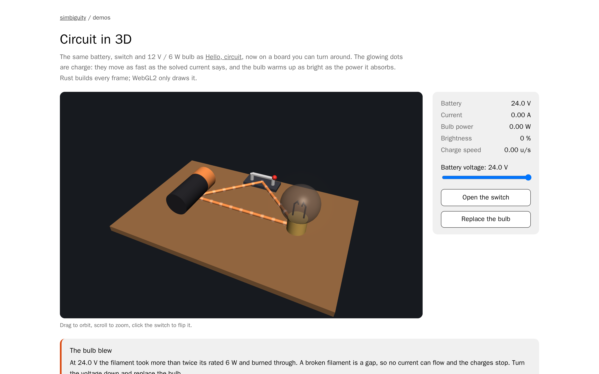
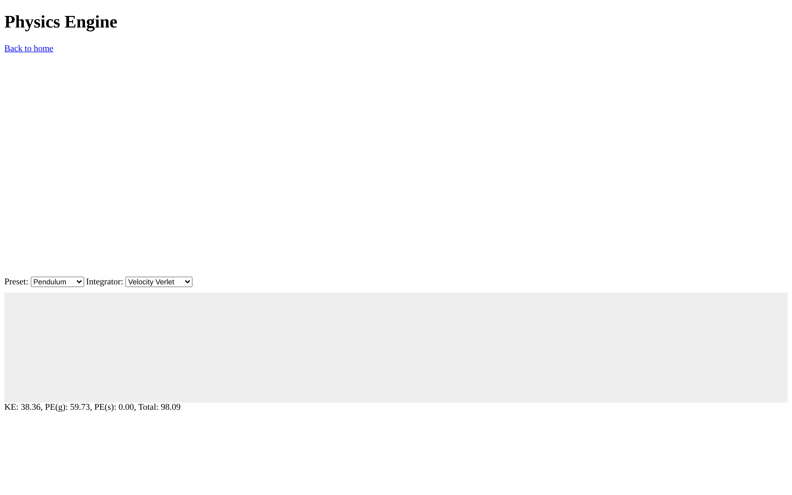
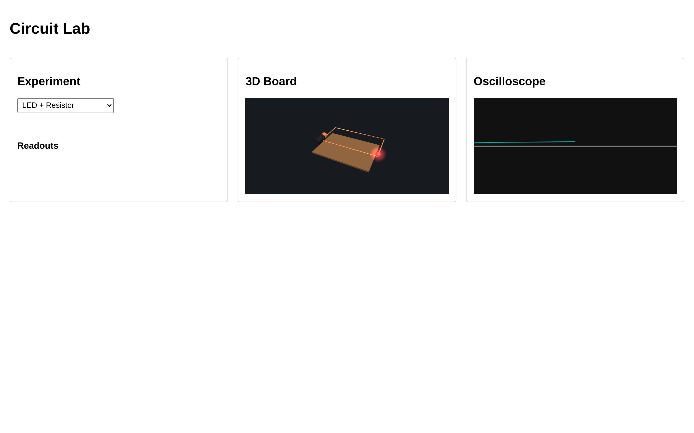
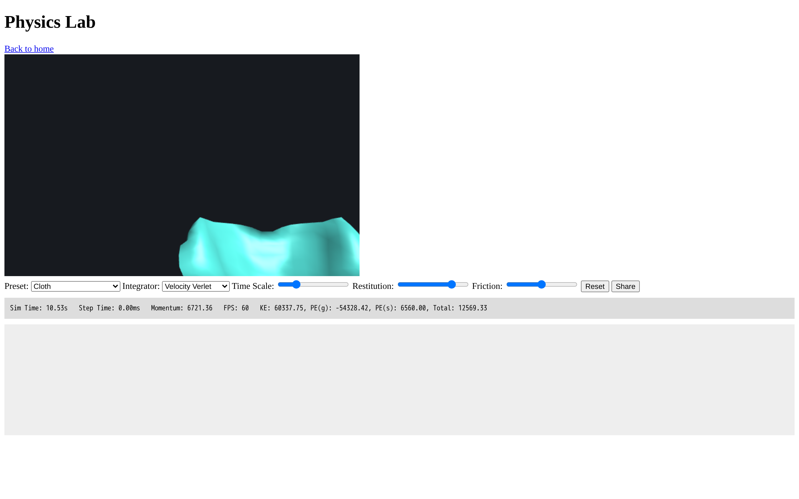
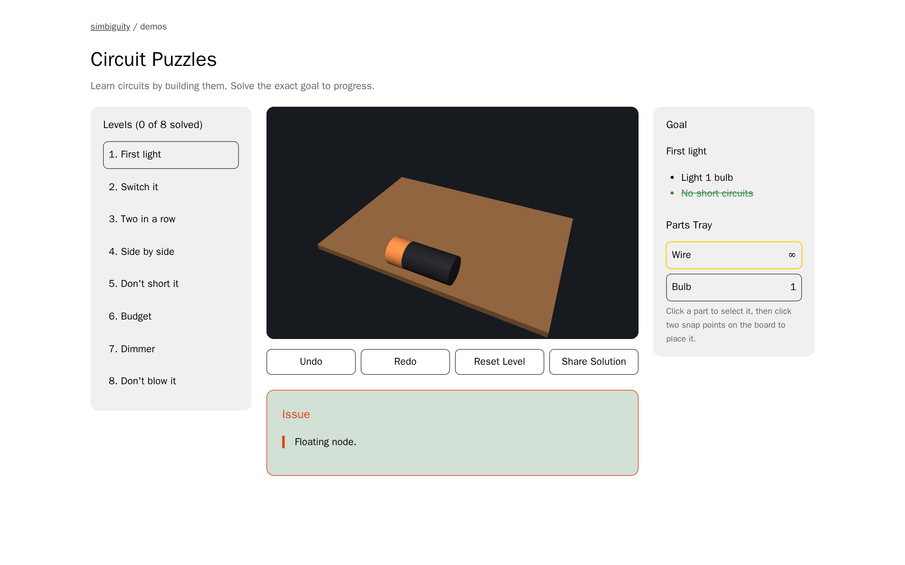
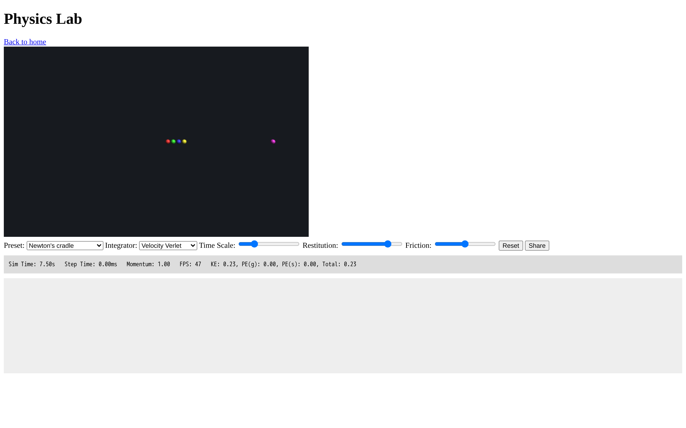

# simbiguity

**An open source simulation engine by The Ambiguity Project.**

simbiguity is a family of small, independently importable Rust crates for
simulation, 3D rendering and animation — built from scratch, with zero external
dependencies in the engine crates, and designed first for education.

Take only what you need: just the circuit solver, just the physics, just the
animation library. Every engine shares the same small set of contracts, so they
compose: a circuit can drive a motor that spins a rigid body, all stepped in
lockstep on one clock.

## Crates (planned)

| Crate | Purpose |
|---|---|
| `simbiguity-math` | Vectors, matrices, quaternions, linear solvers |
| `simbiguity-core` | `Simulation` trait, fixed-timestep clock, seeded RNG, snapshot/restore |
| `simbiguity-circuits` | Circuit solver: DC, then transient and AC |
| `simbiguity-physics` | Particles, springs, pendulums, orbits, collisions |
| `simbiguity-markets` | Order books, agent-based traders, price models |
| `simbiguity-anim` | Easing, tweens, timelines, keyframes, spring motion |
| `simbiguity-render` | Renderer-agnostic scene and draw-command data |
| `simbiguity-plot3d` | 3D surfaces, scatter and time-series charts |

## Design principles

- **Zero dependencies** in the engine crates — `std` only, `no_std + alloc` where possible.
- **Deterministic** — fixed timesteps and seeded randomness, so every run is reproducible
  and puzzle solutions can be checked exactly.
- **Readable** — the source is part of the lesson.
- **Portable** — engines run natively or in the browser. Web embedding uses a
  hand-written WASM interface (plain `extern "C"` exports and shared memory buffers)
  and a from-scratch WebGL2 renderer; no `wasm-bindgen`.

## Demos

Interactive demos live in [`site/`](site/) and are published to GitHub Pages. They
double as the reference for how your own project can embed the engines.

- [Hello, circuit](site/demos/hello-circuit/) — a battery, a switch and a bulb, solved
  live by `simbiguity-circuits` through the hand-written bridge in
  [`crates/simbiguity-circuits-wasm`](crates/simbiguity-circuits-wasm) and the
  ~150-line loader [`site/js/simbiguity.js`](site/js/simbiguity.js).
- [Circuit in 3D](site/demos/circuit-3d/) — the same circuit on a board you can orbit,
  with charge flowing as fast as the solved current and a bulb that warms up on a spring.
  `simbiguity-anim`, `simbiguity-render` and `simbiguity-circuits-view` build every frame
  as draw commands in Rust (bridge: [`crates/simbiguity-render-wasm`](crates/simbiguity-render-wasm));
  [`site/js/webgl2-executor.js`](site/js/webgl2-executor.js) only replays them with WebGL2.

To run them locally you need the `wasm32-unknown-unknown` target
(`rustup target add wasm32-unknown-unknown`) and Python 3 for a static server:

```sh
sh scripts/build-site.sh            # builds the .wasm into site/pkg/
python3 -m http.server -d site 8000 # then open http://localhost:8000
```

The demo pages' logic has its own tests, run with Node 22 or newer (no npm install needed):
`node --test "site/**/*.test.js"`.

### Engine status page

[`site/status/`](site/status/) lists everything the engines can do, each with its live
demo and the tests that prove it, plus every test in the workspace with the comment written
above it. Its data, `site/status/report.json`, is generated on deploy and not committed. To
build it locally:

```sh
cargo run -p xtask -- site-report   # runs every crate's tests, writes site/status/report.json
```

Capabilities are declared next to the code in each crate's `capabilities.toml`.

## License

Licensed under either of

- Apache License, Version 2.0 ([LICENSE-APACHE](LICENSE-APACHE))
- MIT license ([LICENSE-MIT](LICENSE-MIT))

at your option.

<!-- codeyam:run-and-edit:start d=e0ed0650698f -->
## Develop this project with codeyam-editor

This project is built with [codeyam-editor](https://codeyam.com) — code and runnable data scenarios are authored side by side against a live preview.

```bash
# Clone the repo
git clone https://github.com/jaredcosulich/simbiguity && cd simbiguity

# Install codeyam-editor
npm install -g @codeyam-editor/codeyam-editor@latest

# Launch the editor (split-screen terminal + live preview)
codeyam-editor start
```
<!-- codeyam:run-and-edit:end -->

<!-- codeyam:scenario-gallery:start d=1950940fb6b1 -->
## Scenario gallery

States captured as runnable scenarios with codeyam-editor:

### Ball pit settled



Ball pit settled.

### Circuit 3D Parallel - Working



Parallel branches with current visibly splitting.

### Circuit 3D - Bulb Blown



Far too much voltage burns the filament through: the glass goes smoky, the broken filament shows, the charges stop, and the panel offers to replace the bulb.

### Physics Engine Demo



Demonstrates physics features

### Circuit Lab Demo



Circuit Lab Demo.

### Cloth



Cloth.

### Corrupted share link



Corrupted share link.

### Cradle mid-swing



Cradle mid-swing.
<!-- codeyam:scenario-gallery:end -->
